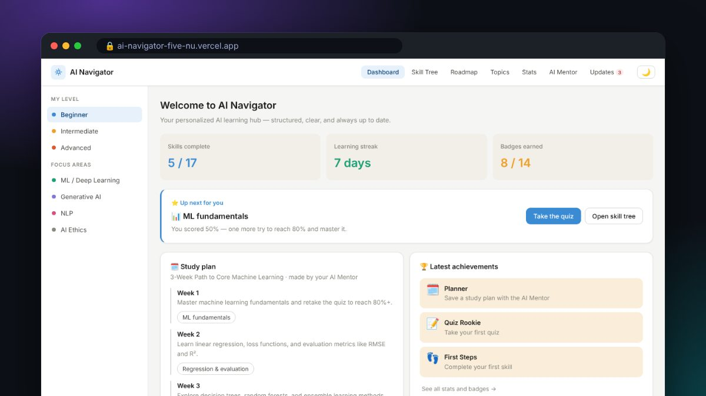
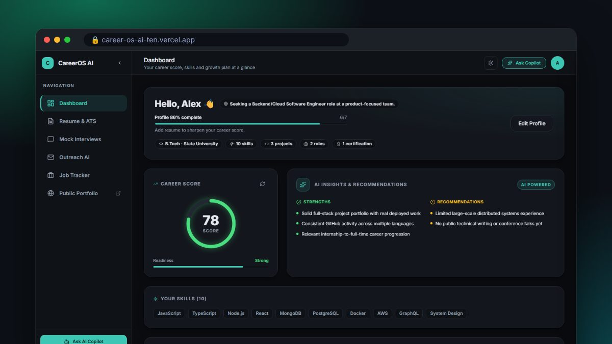
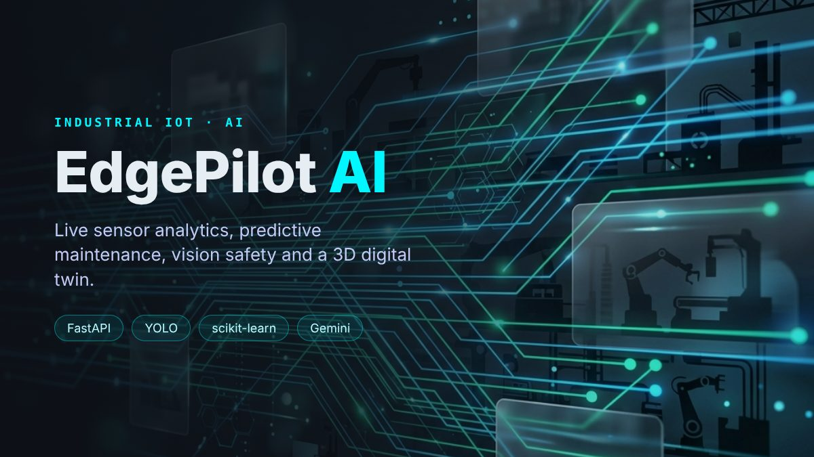
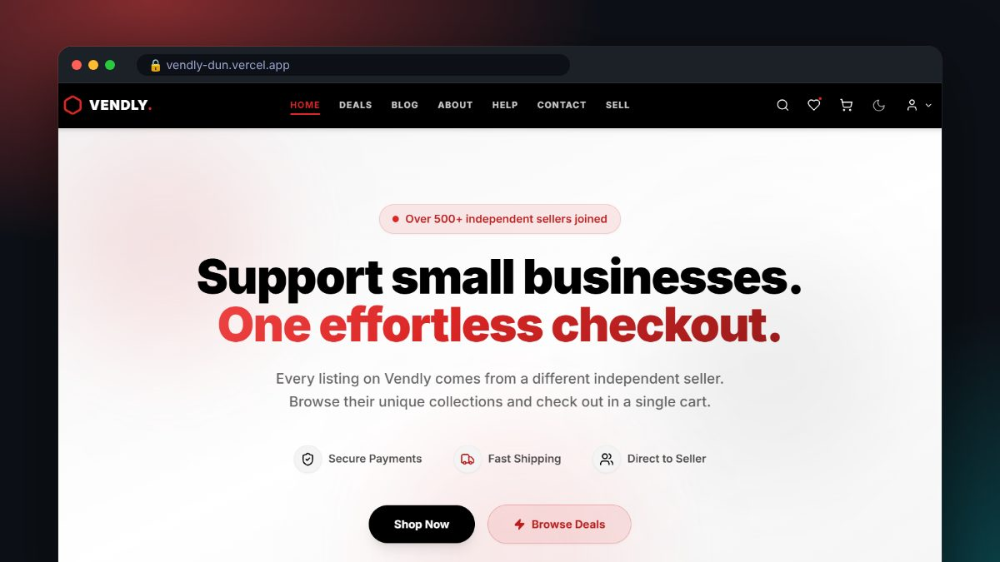
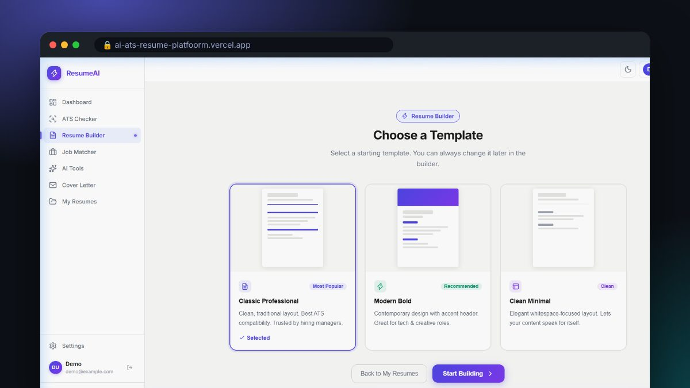
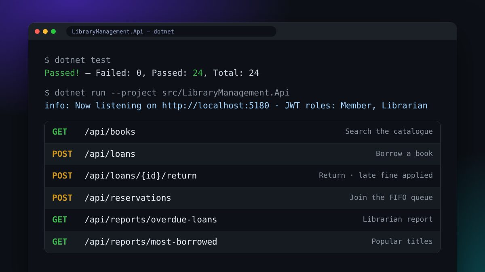

<div align="center">



</div>

<div align="center">

[](https://git.io/typing-svg)

</div>

<br/>

<div align="center">

[](https://github.com/Rishabh893-ux/Rishabh-Portfolio)
[](https://www.linkedin.com/in/rishabh-kasaudhan-0a960724a/)
[](mailto:rkasaudhan87@gmail.com)
[](https://github.com/Rishabh893-ux)
[](https://instagram.com/rishabhkasaudhan4364)

</div>
 
<br/>

---


## 🧠 About me

```typescript
const rishabh = {
  role: ["AI Engineer", "Full Stack Developer"],
  location: "India 🇮🇳",
  mindset: "Build → Ship → Iterate 🚀",
  focus: [
    "AI-powered web applications",
    "Scalable full stack architectures"
  ],
  askMeAbout: ["Python", "React", "MongoDB", "GenAI"],
  funFact: "I build what I wish already existed. ✨",
  status: "Building in public",
  openTo: ["Collaborations", "Internships", "Freelance"]
};
```

---

## 🛠️ Tech stack

<div align="center">

### Languages
<a href="https://skillicons.dev">
  
</a>

### Frontend
<a href="https://skillicons.dev">
  
</a>

### Backend & Database
<a href="https://skillicons.dev">
  
</a>

### AI & Automation
<div align="center">
  
  
  
  
  
</div>

### Cloud & DevOps
<a href="https://skillicons.dev">
  
</a>

</div>

---

## 🚀 Featured projects

<div align="center">
<table>
<tr>
<td width="50%" valign="top">

### 🧭 [AI Navigator](https://github.com/Rishabh893-ux/AI-Navigator-)

<a href="https://ai-navigator-five-nu.vercel.app"></a>
> AI learning platform with an **agent** mentor

A game-style skill tree of 17 AI skills with quizzes, an adaptive learning path, badges and stats. Its Gemini mentor uses **function calling** to quiz you, save study plans and update your progress, with Undo.

`Next.js 16` `TypeScript` `Gemini` `Vitest`

[](https://ai-navigator-five-nu.vercel.app)
[](https://github.com/Rishabh893-ux/AI-Navigator-)

</td>
<td width="50%" valign="top">

### 💼 [CareerOS AI](https://github.com/Rishabh893-ux/CareerOS-AI)

<a href="https://career-os-ai-ten.vercel.app"></a>
> Career-readiness platform that shows its working

Profile, resume, GitHub analysis, mock interviews, outreach and job tracking in one place, with explainable scores computed from real signals.

`Next.js 16` `Node.js` `MongoDB Atlas` `CI`

[](https://career-os-ai-ten.vercel.app)
[](https://github.com/Rishabh893-ux/CareerOS-AI)

</td>
</tr>
<tr>
<td width="50%" valign="top">

### ⚡ [EdgePilot AI](https://github.com/Rishabh893-ux/EdgePilot_AI)

<a href="https://edge-pilot-ai.vercel.app"></a>
> Industrial IoT intelligence platform

Real-time sensor analytics, predictive maintenance, computer-vision safety monitoring and an AI copilot, with a 3D digital twin of the machine.

`Next.js` `FastAPI` `scikit-learn` `YOLO` `Gemini`

[](https://edge-pilot-ai.vercel.app)
[](https://github.com/Rishabh893-ux/EdgePilot_AI)

</td>
<td width="50%" valign="top">

### 🛍️ [Vendly by Bazaario](https://github.com/Rishabh893-ux/Bazaario-ECommerce-Platform)

<a href="https://vendly-dun.vercel.app"></a>
> Multi-vendor e-commerce marketplace

One cart across many sellers, Stripe Connect payouts split automatically to vendors, seller dashboards with revenue charts, and admin moderation.

`Next.js` `Prisma` `MongoDB` `Stripe` `NextAuth`

[](https://vendly-dun.vercel.app)
[](https://github.com/Rishabh893-ux/Bazaario-ECommerce-Platform)

</td>
</tr>
<tr>
<td width="50%" valign="top">

### 📄 [AI ATS Resume Platform](https://github.com/Rishabh893-ux/AI-ATS-RESUME-PLATFOORM)

<a href="https://ai-ats-resume-platfoorm.vercel.app"></a>
> Resume builder + ATS score checker

A drag-and-drop resume builder, ATS scoring, job-description matching, AI cover letters and version history, with PDF and DOCX export.

`Next.js` `TypeScript` `MongoDB` `Gemini` `NextAuth`

[](https://ai-ats-resume-platfoorm.vercel.app)
[](https://github.com/Rishabh893-ux/AI-ATS-RESUME-PLATFOORM)

</td>
<td width="50%" valign="top">

### 📚 [Library Management API](https://github.com/Rishabh893-ux/Library-Management-system)

<a href="https://github.com/Rishabh893-ux/Library-management-system"></a>
> REST API backend for running a library

Catalogue, loans with automatic late fines, a fair first-come-first-served reservation queue and librarian reports. JWT roles and 24 passing tests.

`C#` `.NET 8` `EF Core` `SQL Server`

[](https://github.com/Rishabh893-ux/Library-Management-system)

</td>
</tr>
</table>
</div>

---

## 📦 More projects

<div align="center">

| Project | Description | Stack | Live |
|:---|:---|:---|:---:|
| [🧭 Waypoint](https://github.com/Rishabh893-ux/WaypointLearningPath) | AI learning-path recommender: turns your goals into an ordered roadmap with a progress dashboard | `Next.js` `Gemini` `Recharts` | [🌐 Demo](https://waypointlearningpath.vercel.app) |
| [🔍 OMR Answer Sheet Processor](https://github.com/Rishabh893-ux/Omr-answer-sheet-processor) | Automated answer-sheet grading with computer vision, batch processing and reports | `Python` `OpenCV` | — |
| [🌤️ Skyline Weather](https://github.com/Rishabh893-ux/Skyline-Weather-App) | Weather app with 7-day and hourly forecasts, air quality, UV and location search | `JavaScript` `Open-Meteo` | — |
| [🤖 College Enquiry Chatbot](https://github.com/Rishabh893-ux/college-enquiry-chatbot) | Intent-classification chatbot for admission, fees, courses and hostel questions | `Python` `Flask` `scikit-learn` | — |

</div>

---

## ✅ Highlights

| | |
|:---:|:---|
| 🚀 | **10+ public projects** across AI, full stack and backend, with **6 live on Vercel** |
| 🤖 | Built an **AI agent** with Gemini function calling: the AI Navigator mentor acts in the app, with Undo |
| 💳 | Integrated **Stripe Connect** for automatic multi-vendor payouts (Vendly) |
| 🔐 | Shipped a **.NET 8 REST API** with JWT roles, EF Core and 24 passing tests |
| 👁️ | Applied **computer vision**: OpenCV grading (OMR) and YOLO safety monitoring (EdgePilot) |
| 🧪 | Write **tests and CI** for my projects: Vitest, xUnit and GitHub Actions |

---

## 🏗️ What I'm building now

```
AI Navigator v3      ██████████████ 100%  Skill tree + AI agent mentor — shipped ✅
Portfolio v3         ██████░░░░░░░░  40%  Next.js personal site with animations
```

---

## 📊 GitHub Dashboard

<div align="center">
  <table width="100%">
    <tr>
      <td width="50%" valign="top" align="center">
        
      </td>
      <td width="50%" valign="top" align="center">
        
      </td>
    </tr>
    <tr>
      <td colspan="2" valign="top" align="center">
        
      </td>
    </tr>
    <tr>
      <td colspan="2" valign="top" align="center">
        
      </td>
    </tr>
  </table>
</div>

<br/>

<div align="center">
  <picture>
    <source media="(prefers-color-scheme: dark)" srcset="https://raw.githubusercontent.com/Rishabh893-ux/Rishabh893-ux/output/github-snake-dark.svg"/>
    <source media="(prefers-color-scheme: light)" srcset="https://raw.githubusercontent.com/Rishabh893-ux/Rishabh893-ux/output/github-snake.svg"/>
    
  </picture>
</div>

---

## ✍️ Dev quote

<div align="center">


</div>

---

<div align="center">

*Open to internships, freelance work, and interesting collaborations.*

**If you like what I build — drop a ⭐ on a repo.**

<br/>


</div>

<br/>


